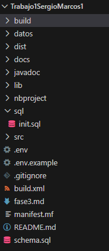
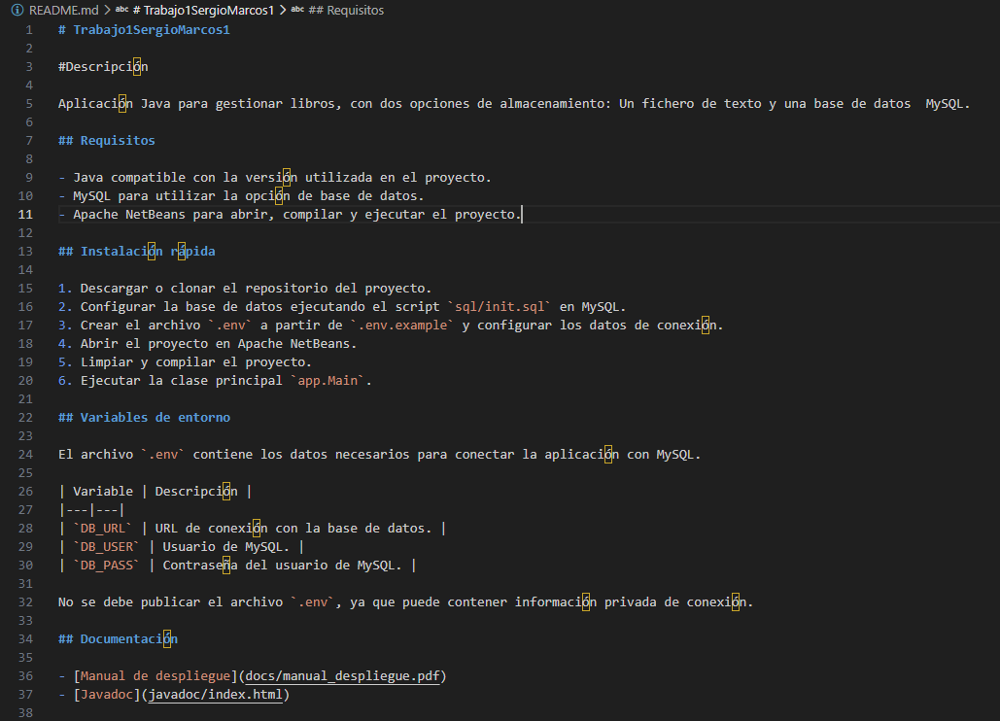
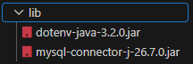
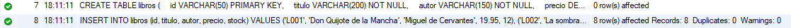
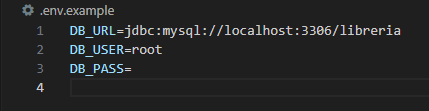
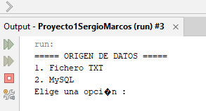
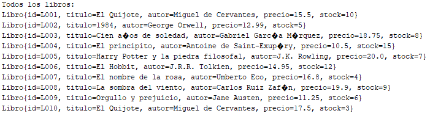
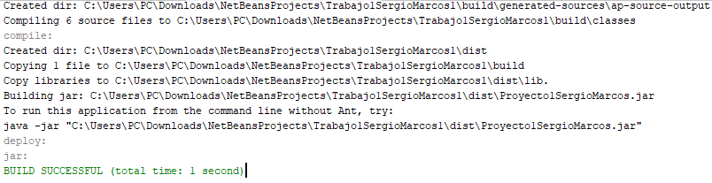

Manual de despliegue - Sistema de Gestión de Biblioteca
## 1. Introducción y alcance

Este manual explica cómo instalar, configurar, ejecutar y administrar la aplicación Java de gestión de libros del proyecto `Trabajo1SergioMarcos1`. La aplicación permite trabajar con dos formas de almacenamiento: un fichero de texto y una base de datos MySQL.

Está dirigido a una persona con conocimientos básicos de Windows que necesite preparar el proyecto en su ordenador, aunque no haya trabajado antes con él.

El manual incluye los requisitos necesarios, la obtención del código, la configuración de las librerías, la inicialización de la base de datos, la configuración del archivo `.env`, el arranque de la aplicación y las comprobaciones necesarias para verificar su funcionamiento. También recoge tareas de administración y posibles errores durante la instalación.

Las comprobaciones realizadas hasta el momento se indican en los apartados correspondientes. La prueba completa del despliegue en un equipo limpio y la validación por otra persona quedan pendientes.

Al terminar el despliegue, se deberá poder ejecutar la aplicación y utilizar sus dos opciones de almacenamiento.

## 2. Requisitos y entorno de pruebas
## 2.1. Requisitos de software
Las versiones comprobadas en el equipo de desarrollo son las siguientes:

| Software | Versión | Para qué se utiliza |
|---|---|---|
| Java | 26.0.1 (64 bits) | Compilar y ejecutar la aplicación Java. |
| Apache NetBeans | IDE 31 | Abrir, compilar y ejecutar el proyecto Ant. |
| MySQL Community Server | 8.0.46 (64 bits) | Gestionar la base de datos de libros. |
| Git | 2.55.0.windows.5 | Obtener el código del repositorio. |

## 2.2. Entorno de pruebas
Las versiones anteriores se han consultado en el equipo de desarrollo. La prueba completa del despliegue desde una instalación limpia queda pendiente.

El proyecto utiliza Apache NetBeans y una base de datos MySQL. Para comprobar el despliegue desde cero, se preparará un entorno limpio y se documentarán los pasos realizados y sus resultados.

## 3. Instalación del software necesario
Para desplegar la aplicación se necesitan los siguientes programas:

Java JDK: permite compilar y ejecutar la aplicación Java.
Apache NetBeans: permite abrir, compilar y ejecutar el proyecto, que utiliza Ant.
MySQL Community Server: permite utilizar el repositorio de libros basado en una base de datos.
Git: permite obtener el código del repositorio.

Las versiones comprobadas en el equipo de desarrollo están indicadas en el apartado 2.1.

La instalación de estos programas se deberá realizar siguiendo las instrucciones oficiales de cada herramienta. Durante la prueba de despliegue en un equipo limpio se documentarán los pasos realizados y se añadirán las capturas de pantalla correspondientes.

Estado de la prueba: pendiente de realizar en un equipo limpio.

## 4. Estructura del proyecto

El proyecto está organizado en diferentes carpetas y archivos para separar el código fuente, las librerías, los datos y la documentación.

- `src/`: contiene el código fuente Java de la aplicación.
- `datos/`: contiene los datos utilizados por la aplicación que trabaja con ficheros de texto.
- `lib/`: contiene las librerías necesarias para compilar y ejecutar el proyecto.
- `sql/`: contiene el script `init.sql`, utilizado para preparar la base de datos MySQL.
- `docs/`: contiene la documentación del proyecto y las imágenes utilizadas en ella.
- `javadoc/`: contiene la documentación generada a partir del código Java.
- `nbproject/`: contiene los archivos de configuración del proyecto de NetBeans.
- `.env.example`: sirve como plantilla para configurar la conexión con MySQL.
- `.gitignore`: indica los archivos y carpetas que Git debe ignorar.
- `README.md`: contiene la descripción del proyecto y las instrucciones básicas de instalación.

El archivo `build.xml` contiene la configuración de construcción del proyecto mediante Ant.

La estructura descrita corresponde a la organización del proyecto en el momento de redactar este manual.

**Figura 4.1. Estructura del proyecto.**

## 5. Obtención del código fuente

El código fuente del proyecto debe obtenerse desde la ubicación donde esté disponible el repositorio Git, descargándolo o clonándolo según el método de acceso utilizado.

Una vez obtenido el proyecto, hay que comprobar que la carpeta contiene los archivos y directorios necesarios, como `src/`, `lib/`, `sql/`, `nbproject/`, `build.xml` y `README.md`.

También se debe comprobar que el archivo `.env.example` está disponible para configurar la conexión con la base de datos.

El archivo `.env` contiene los datos de conexión del entorno y no debe compartirse ni incluirse en el repositorio.

**Figura 5.1. Archivo README del proyecto.**

## 6. Librerías necesarias

El proyecto utiliza dos librerías externas:

- `dotenv-java-3.2.0.jar`: permite leer las variables de configuración del archivo `.env`.
- `mysql-connector-j-26.7.0.jar`: permite conectar la aplicación Java con MySQL.

Ambos archivos JAR se encuentran en la carpeta `lib/` del proyecto.

Las rutas de las librerías están configuradas en `nbproject/project.properties` mediante rutas relativas al proyecto. De esta forma, no dependen de las carpetas personales del equipo donde se desarrolló la aplicación.

Para comprobar la configuración, se abrió el proyecto en Apache NetBeans y se ejecutó una limpieza y compilación. El resultado fue satisfactorio y la construcción finalizó correctamente.

**Figura 6.1. Bibliotecas necesarias del proyecto.**

## 7. Inicialización de la base de datos

El proyecto incluye el script `sql/init.sql`, que prepara la base de datos `libreria` y crea la tabla `libros` con los campos necesarios para la aplicación.

El script también inserta ocho libros de ejemplo para poder realizar las comprobaciones iniciales.

**Advertencia:** el script elimina la tabla `libros` si ya existe y vuelve a crearla. Por tanto, al ejecutarlo se perderán los datos anteriores de esa tabla.

La ejecución del script `sql/init.sql` en MySQL Workbench finalizó sin errores. Después, se comprobó que la tabla `libros` existe en la base de datos `libreria` y que contiene los ocho registros de ejemplo esperados.

**Figura 7.1. Ejecución de la creación de la base de datos.**

**Figura 7.2. Creación de la tabla e inserción de los datos de ejemplo.**

## 8. Configuración del archivo `.env`

La aplicación utiliza el archivo `.env` para obtener los datos necesarios para conectarse a MySQL. La clase `ConexionBD` lee las siguientes variables de entorno:

- `DB_URL`: URL de conexión con la base de datos.
- `DB_USER`: usuario de MySQL.
- `DB_PASS`: contraseña del usuario de MySQL.

El proyecto incluye el archivo `.env.example` como plantilla. Para configurar la conexión, se debe crear un archivo llamado `.env` en la raíz del proyecto y completar sus valores con los datos del entorno donde se ejecutará la aplicación.

El archivo `.env` no debe publicarse en el repositorio, ya que puede contener información privada. Por ese motivo, está incluido en `.gitignore`.

La configuración se comprobó ejecutando la aplicación desde Apache NetBeans. Se seleccionó la opción MySQL y, dentro de su menú, la opción 1 para mostrar todos los libros. La aplicación mostró los registros de la base de datos correctamente.

**Figura 8.1. Plantilla de configuración de la conexión a MySQL.**

## 9. Arranque de la aplicación

Para iniciar la aplicación, se abre el proyecto `Trabajo1SergioMarcos1` en Apache NetBeans y se ejecuta la clase principal `app.Main`.

Al iniciarse, la aplicación muestra un menú que permite elegir entre trabajar con un fichero de texto o utilizar MySQL.

Para utilizar la base de datos, se selecciona la opción MySQL del menú principal. A continuación, se muestra el menú de operaciones correspondiente.

Se ha comprobado que la aplicación se inicia correctamente desde Apache NetBeans y que la opción de mostrar todos los libros permite consultar los registros almacenados en MySQL.

**Figura 9.1. Menú principal de la aplicación.**

**Figura 9.2. Menú de la opción MySQL.**

## 10. Comprobaciones del despliegue

Durante las comprobaciones realizadas en el equipo de desarrollo se han verificado los siguientes puntos:

- La limpieza y compilación del proyecto finaliza correctamente en Apache NetBeans.
- La aplicación se inicia y muestra el menú principal.
- Es posible acceder al menú de operaciones de MySQL.
- La opción para mostrar todos los libros presenta los registros almacenados en la base de datos.
- La tabla `libros` contiene los ocho registros insertados mediante `sql/init.sql`.

La prueba completa desde un equipo limpio queda pendiente de realizarse.

Las comprobaciones se acompañan de capturas de pantalla que muestran los resultados obtenidos, evitando mostrar contraseñas u otros datos privados.

**Figura 10.1. Aplicación mostrando los libros almacenados en MySQL.**

**Figura 10.2. Compilación correcta del proyecto en NetBeans.**

## 11. Administración

### 11.1. Copias de seguridad

Antes de realizar cambios importantes en los datos, se recomienda crear una copia de seguridad de la información que se quiera conservar.

La aplicación permite trabajar con un fichero de texto o con una base de datos MySQL. Por tanto, las copias de seguridad deben realizarse teniendo en cuenta dónde están almacenados los datos.

En el caso de MySQL, se puede utilizar MySQL Workbench para exportar la base de datos. Si se utiliza el fichero de texto, se debe guardar una copia del fichero original en otra ubicación.

### 11.2. Configuración

Los datos de conexión con MySQL se mantienen en el archivo `.env`. Si cambia el servidor, el usuario o la contraseña, será necesario actualizar los valores correspondientes.

El archivo `.env` debe mantenerse fuera del repositorio para proteger la información de conexión. El archivo `.env.example` sirve como plantilla para configurar las variables necesarias.

### 11.3. Mantenimiento

Después de modificar el código o las librerías, se debe limpiar y compilar el proyecto en Apache NetBeans y comprobar que la aplicación se inicia correctamente.

Antes de volver a ejecutar `sql/init.sql`, hay que recordar que el script elimina y recrea la tabla `libros` y vuelve a insertar los registros de ejemplo. Por tanto, su ejecución puede provocar la pérdida de los datos que hubiera previamente en esa tabla.

### 11.4. Realizar una copia de seguridad de la base de datos

1. Abrir MySQL Workbench y conectarse al servidor MySQL.
2. Seleccionar **Server → Data Export**.
3. Seleccionar la base de datos `libreria` y sus tablas.
4. Elegir la opción **Export to Self-Contained File**.
5. Indicar la ruta y el nombre del archivo de copia de seguridad.
6. Pulsar **Start Export** para generar el archivo.

La copia de seguridad permite conservar los datos de la base de datos para poder recuperarlos posteriormente.

### 11.5. Restaurar una copia de seguridad

1. Crear una base de datos de prueba llamada `libreria_prueba`.
2. Abrir MySQL Workbench y acceder a **Server → Data Import**.
3. Seleccionar el archivo `copia_libreria.sql` mediante **Import from Self-Contained File**.
4. Seleccionar `libreria_prueba` como esquema de destino.
5. Pulsar **Start Import**.
6. Ejecutar las consultas `SHOW TABLES;` y `SELECT * FROM libros;` para comprobar la restauración.

Resultado: la restauración se ha realizado correctamente y se han recuperado los ocho libros en la base de datos de prueba.

## 12. Resolución de problemas
## 12.1. El archivo init.sql está vacío
Problema: al abrir sql/init.sql en MySQL Workbench, el editor aparecía vacío.

Solución: se comprobó el archivo en Visual Studio Code, se añadió el script SQL de inicialización, se guardó y se volvió a abrir en Workbench. Después, se ejecutó correctamente.

## 12.2. El comando mysql no se reconoce
Problema: al ejecutar mysql --version desde CMD, Windows no encontraba el comando.

Solución: se utilizó la ruta completa del ejecutable mysql.exe, situado en la carpeta de instalación de MySQL. Así se pudo consultar la versión instalada.

### 12.3. La máquina virtual aparece como «Abortada»

Problema: al intentar iniciar la máquina virtual de Windows 10 en VirtualBox, la máquina terminó con el estado «Abortada».

Causa: la virtualización por hardware del equipo no estaba activada.

Solución: se activó la virtualización en la configuración BIOS/UEFI del equipo y se volvió a iniciar la máquina virtual. Después, Windows comenzó el proceso de carga y preparación.

## 12.4. Incidencias adicionales pendientes
Durante las pruebas posteriores de instalación, configuración y ejecución se documentarán las incidencias reales que se produzcan, indicando para cada una el problema observado, su causa cuando se conozca y la solución aplicada.

Estado: todavía no se han documentado las ocho incidencias reales exigidas por la guía. Este apartado queda pendiente de completar con los resultados de las pruebas.

### 12.5. La máquina virtual vuelve a iniciar la instalación de Windows 10

Problema: al iniciar la máquina virtual de VirtualBox, volvía a aparecer el instalador de Windows 10 en lugar de entrar al sistema operativo ya instalado.

Causa: el archivo ISO de instalación de Windows 10 seguía conectado en la unidad óptica virtual y la máquina arrancaba desde ese medio.

### 12.6. Comando no reconocido en Windows

Problema: al ejecutar un comando que no existe en el Símbolo del sistema, Windows muestra el mensaje: «no se reconoce como un comando interno o externo, programa o archivo por lotes ejecutable».

Causa: el comando introducido no corresponde a un programa ejecutable reconocido por Windows ni a un comando disponible en el sistema.

Solución: comprobar que el nombre del comando está escrito correctamente y que el programa está instalado y disponible en la ruta del sistema si corresponde.

Resultado: se ha identificado la causa del mensaje y cómo corregirlo.

Solución:
1. Apagar la máquina virtual.
2. Abrir la configuración de la máquina en VirtualBox.
3. Entrar en el apartado **Almacenamiento**.
4. Seleccionar la unidad óptica que tenía conectado el ISO de Windows 10.
5. Desconectar el ISO de la unidad virtual, sin borrar el archivo ISO del ordenador.
6. Iniciar de nuevo la máquina virtual.

Resultado: la máquina virtual arranca desde el disco virtual donde está instalado Windows 10, en lugar de volver a iniciar el instalador.

## 13. Informe de validación cruzada

La validación cruzada consiste en entregar el manual de despliegue a otra persona o grupo para que intente instalar y ejecutar la aplicación siguiendo las instrucciones, sin ayuda directa de quien ha desarrollado el proyecto.

La prueba permitirá comprobar si los pasos se entienden, si falta información y si aparecen problemas durante la instalación o la ejecución.

### 13.1. Resultado de la validación

Estado: pendiente de realizar.

La persona o grupo que realice la prueba deberá indicar los pasos completados, los errores encontrados y las correcciones necesarias en el manual.

### 13.2. Correcciones

Este apartado se completará después de recibir los resultados de la validación cruzada. Se anotarán los problemas detectados y los cambios realizados en la documentación.

