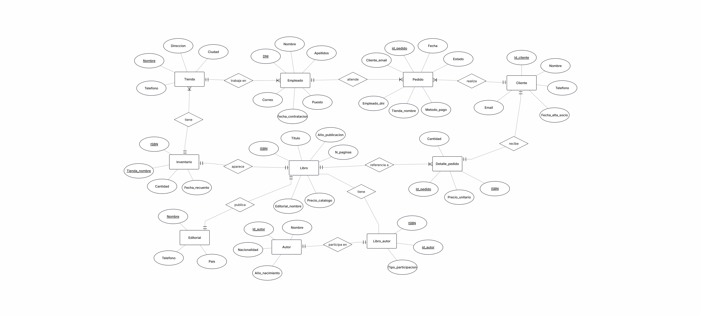

# Base de datos de Páginas de Villa Serena

## 1. Resumen del caso
Páginas de Villa Serena es una libreria que cuenta con tres tiendas: Centro, Ribera y Universidad. La librería trabaja con libros de diferentes autores y editoriales y también tiene empleados, clientes y un sistema de pedidos. La libreria necesita tener organizada toda esta información porque los libros pueden estar disponibles en unas tiendas y no en otras, los empleados trabajan en una tienda concreta y los clientes pueden realizar pedidos. Además, un pedido puede incluir varios libros y es necesario guardar la cantidad y el precio que se pagó por cada uno. La base de datos servirá para guardar y relacionar toda esta información. También permitirá consultar datos como el stock de los libros en cada tienda, los pedidos realizados, las ventas y la información relacionada con los autores y las editoriales. De esta forma, la librería podrá gestionar mejor la información de sus tiendas y realizar las consultas necesarias sobre su  actividad. 
## 2. Análisis del caso
## 2.1 Entidades y atributos
| Entidad | Atributos |
|---|---|
| Tienda | nombre, dirección, teléfono, ciudad |
| Libro | ISBN, titulo, año de publicación, número de páginas, precio de catálogo |
| Editorial | nombre, país, teléfono |
| Autor | nombre, nacionalidad, año de nacimiento |
| Inventario | cantidad de stock, fecha del último recuento |
| Empleado | DNI, nombre, apellidos, puesto, fecha de contratación, correo electrónico de trabajo |
| Cliente | nombre completo, correo electrónico, teléfono, fecha de alta |
| Pedido | fecha, método de pago, estado |
## 2.2 Relaciones
| Relación | Cardinalidad | Descripción |
|---|---|---|
| Tienda - Empleado | 1:N | Una tienda puede tener varios empleados y cada empleado trabaja en una única tienda. |
| Tienda - Inventario | 1:N | Una tienda puede tener varios registros de inventario y cada registro de inventario corresponde a una única tienda. |
| Libro - Editorial | N:1 | Una editorial puede publicar varios libros y cada libro pertenece a una única editorial. |
## 2.3 Datos descartados
| Dato | Motivo |
|---|---|
| Total del pedido | No se guarda directamente porque se puede calcular a partir de las cantidades y los precios de los libros incluidos en el pedido. |
| Datos de las líneas de pedido que se pueden calcular | No se guardan resultados que se puedan obtener a partir de la cantidad y del precio pagado por cada libro. |
| Historial de cambios de tienda de los empleados | No se guarda porque el caso indica que no es necesario conservar el historial de traslados de los empleados. |
## 3. Reglas de negocio
La librería tiene tres tiendas: Centro, Ribera y Universidad. De cada tienda se guarda el nombre, la dirección, el teléfono y la ciudad.
Cada libro se identifica mediante un ISBN de 13 dígitos y tiene un título, un año de publicación, un número de páginas y un precio de catálogo.
Cada libro pertenece a una única editorial. De cada editorial se guarda el nombre, el país y el teléfono.
Un libro puede tener varios autores y un autor puede participar en varios libros. Además, se debe distinguir si el autor es principal o colaborador en cada libro.
El inventario se registra por libro y tienda, indicando la cantidad disponible y la fecha del último recuento. Si no existe un registro de inventario para un libro en una tienda, significa que ese libro no está disponible en ella.
Cada empleado trabaja en una única tienda. De cada empleado se guarda el DNI, el nombre, los apellidos, el puesto, la fecha de contratación y el correo electrónico de trabajo.
Los puestos de los empleados pueden ser librero, cajero o encargado. No se guarda el historial de los cambios de tienda de los empleados.
De los clientes se guarda el nombre, el correo electrónico y, si lo tienen, el teléfono. Para los socios también se registra la fecha de alta. Los clientes que no son socios también deben quedar registrados.
Cada pedido se realiza en una única tienda, lo atiende un empleado y corresponde a un cliente.
Un pedido puede incluir varios libros. Para cada libro incluido se guarda la cantidad comprada y el precio que se pagó por unidad en ese pedido, aunque el precio de catálogo cambie posteriormente.
Los métodos de pago admitidos son efectivo, tarjeta y Bizum.
Los estados posibles de un pedido son preparado, entregado y cancelado.
## 4. Diagrama entidad-relación
El siguiente diagrama representa las entidades de la base de datos de Páginas de Villa Serena, sus atributos principales, las claves primarias y foráneas y las relaciones entre ellas.

Relaciones y cardinalidades
| Relación | Cardinalidad | Descripción |
|---|---|---|
| Tienda - Empleado | 1:N | Una tienda puede tener varios empleados y cada empleado trabaja en una única tienda. |
| Tienda - Inventario | 1:N | Una tienda puede tener varios registros de inventario. |
| Libro - Inventario | 1:N | Un libro puede tener registros de inventario en distintas tiendas. |
| Editorial - Libro | 1:N | Una editorial puede publicar varios libros y cada libro pertenece a una única editorial. |
| Libro - LibroAutor | 1:N | Un libro puede tener varias participaciones de autores. |
| Autor - LibroAutor | 1:N | Un autor puede participar en varios libros. |
| Tienda - Pedido | 1:N | Una tienda puede recibir varios pedidos. |
| Empleado - Pedido | 1:N | Un empleado puede atender varios pedidos y cada pedido lo atiende un único empleado. |
| Cliente - Pedido | 1:N | Un cliente puede realizar varios pedidos. |
| Pedido - DetallePedido | 1:N | Un pedido puede contener varias líneas de detalle. |
| Libro - DetallePedido | 1:N | Un libro puede aparecer en líneas de detalle de distintos pedidos. |

Las tablas Inventario, LibroAutor y DetallePedido permiten representar las relaciones entre varias entidades y guardar los datos propios de cada relación, como las existencias, el tipo de participación del autor, la cantidad comprada y el precio pagado por unidad.
## 5. Modelo lógico
Tabla tienda
| Columna | Clave | Referencia |
|---|---|---|
| nombre | PK | |
| direccion | | |
| telefono | | |
| ciudad | | |

Tabla editorial
| Columna | Clave | Referencia |
|---|---|---|
| nombre | PK | |
| pais | | |
| telefono | | |

Tabla libro
| Columna | Clave | Referencia |
|---|---|---|
| isbn | PK | |
| titulo | | |
| ano_publicacion | | |
| num_paginas | | |
| precio_catalogo | | |
| editorial_nombre | FK | editorial.nombre |

Tabla autor
| Columna | Clave | Referencia |
|---|---|---|
| nombre | | |
| nacionalidad | | |
| ano_nacimiento | | |

Tabla libro_autor
| Columna | Clave | Referencia |
|---|---|---|
| isbn | PK, FK | libro.isbn |
| autor_nombre | PK, FK | autor.nombre |
| tipo_participacion | | |

Tabla inventario
| Columna | Clave | Referencia |
|---|---|---|
| tienda_nombre | PK, FK | tienda.nombre |
| isbn | PK, FK | libro.isbn |
| cantidad | | |
| fecha_recuento | | |

Tabla empleado
| Columna | Clave | Referencia |
|---|---|---|
| dni | PK | |
| nombre | | |
| apellidos | | |
| puesto | | |
| fecha_contratacion | | |
| correo | | |
| tienda_nombre | FK | tienda.nombre |

Tabla cliente
| Columna | Clave | Referencia |
|---|---|---|
| nombre | | |
| email | | |
| telefono | | |
| fecha_alta_socio | | |

Tabla pedido
| Columna | Clave | Referencia |
|---|---|---|
| id_pedido | PK | |
| fecha | | |
| metodo_pago | | |
| estado | | |
| tienda_nombre | FK | tienda.nombre |
| empleado_dni | FK | empleado.dni |
| cliente_email | FK | cliente.email |

Tabla detalle_pedido
| Columna | Clave | Referencia |
|---|---|---|
| id_pedido | PK, FK | pedido.id_pedido |
| isbn | PK, FK | libro.isbn |
| cantidad | | |
| precio_unitario | | |
## 6. Script SQL (schema.sql)
El archivo schema.sql contiene las instrucciones SQL necesarias para crear la base de datos libreria y sus tablas.

El script define las claves primarias y las claves foráneas para relacionar las tablas, así como los tipos de datos y las restricciones necesarias para guardar la información de las tiendas, los libros, las editoriales, los autores, los inventarios, los empleados, los clientes y los pedidos.

El script se ha ejecutado en MySQL Workbench y se han creado las diez tablas sin errores.
## 7. Diccionario de datos
En este apartado se describen las columnas de cada tabla, sus tipos de datos, si son obligatorias y las restricciones que tienen.

### Tabla `tienda`

| Columna | Tipo de dato | Obligatorio | Descripción y restricciones |
|---|---|---|---|
| `nombre` | VARCHAR(100) | Sí | Nombre de la tienda. Clave primaria. |
| `direccion` | VARCHAR(150) | Sí | Dirección de la tienda. |
| `telefono` | VARCHAR(20) | Sí | Teléfono de la tienda. |
| `ciudad` | VARCHAR(100) | Sí | Ciudad donde se encuentra la tienda. |

### Tabla `editorial`

| Columna | Tipo de dato | Obligatorio | Descripción y restricciones |
|---|---|---|---|
| `nombre` | VARCHAR(100) | Sí | Nombre de la editorial. Clave primaria. |
| `pais` | VARCHAR(100) | Sí | País de la editorial. |
| `telefono` | VARCHAR(20) | Sí | Teléfono de contacto de la editorial. |

### Tabla `autor`

| Columna | Tipo de dato | Obligatorio | Descripción y restricciones |
|---|---|---|---|
| `id_autor` | INT | Sí | Identificador del autor. Clave primaria y autoincremental. |
| `nombre` | VARCHAR(100) | Sí | Nombre del autor. |
| `nacionalidad` | VARCHAR(100) | Sí | Nacionalidad del autor. |
| `ano_nacimiento` | INT | Sí | Año de nacimiento del autor. |

### Tabla `cliente`

| Columna | Tipo de dato | Obligatorio | Descripción y restricciones |
|---|---|---|---|
| `id_cliente` | INT | Sí | Identificador del cliente. Clave primaria y autoincremental. |
| `nombre` | VARCHAR(150) | Sí | Nombre completo del cliente. |
| `email` | VARCHAR(150) | Sí | Correo electrónico del cliente. |
| `telefono` | VARCHAR(20) | No | Teléfono del cliente, si dispone de él. |
| `fecha_alta_socio` | DATE | No | Fecha de alta como socio. Puede quedar vacía si el cliente no es socio. |

### Tabla `libro`

| Columna | Tipo de dato | Obligatorio | Descripción y restricciones |
|---|---|---|---|
| `isbn` | CHAR(13) | Sí | ISBN del libro de 13 caracteres. Clave primaria. |
| `titulo` | VARCHAR(200) | Sí | Título del libro. |
| `ano_publicacion` | INT | Sí | Año de publicación del libro. |
| `num_paginas` | INT | Sí | Número de páginas. Debe ser mayor que cero. |
| `precio_catalogo` | DECIMAL(10,2) | Sí | Precio de catálogo del libro. No puede ser negativo. |
| `editorial_nombre` | VARCHAR(100) | Sí | Nombre de la editorial que publica el libro. Clave foránea que referencia a `editorial.nombre`. |

### Tabla `empleado`

| Columna | Tipo de dato | Obligatorio | Descripción y restricciones |
|---|---|---|---|
| `dni` | VARCHAR(15) | Sí | DNI del empleado. Clave primaria. |
| `nombre` | VARCHAR(100) | Sí | Nombre del empleado. |
| `apellidos` | VARCHAR(150) | Sí | Apellidos del empleado. |
| `puesto` | VARCHAR(20) | Sí | Puesto del empleado. Solo admite `librero`, `cajero` o `encargado`. |
| `fecha_contratacion` | DATE | Sí | Fecha de contratación del empleado. |
| `correo` | VARCHAR(150) | Sí | Correo electrónico de trabajo. |
| `tienda_nombre` | VARCHAR(100) | Sí | Nombre de la tienda donde trabaja. Clave foránea que referencia a `tienda.nombre`. |

### Tabla `libro_autor`

| Columna | Tipo de dato | Obligatorio | Descripción y restricciones |
|---|---|---|---|
| `isbn` | CHAR(13) | Sí | ISBN del libro relacionado. Clave primaria compuesta y clave foránea que referencia a `libro.isbn`. |
| `id_autor` | INT | Sí | Identificador del autor relacionado. Clave primaria compuesta y clave foránea que referencia a `autor.id_autor`. |
| `tipo_participacion` | VARCHAR(20) | Sí | Indica si el autor es `principal` o `colaborador`. |

### Tabla `inventario`

| Columna | Tipo de dato | Obligatorio | Descripción y restricciones |
|---|---|---|---|
| `tienda_nombre` | VARCHAR(100) | Sí | Nombre de la tienda donde se encuentra el libro. Clave primaria compuesta y clave foránea que referencia a `tienda.nombre`. |
| `isbn` | CHAR(13) | Sí | ISBN del libro almacenado. Clave primaria compuesta y clave foránea que referencia a `libro.isbn`. |
| `cantidad` | INT | Sí | Unidades disponibles del libro. No puede ser negativa. |
| `fecha_recuento` | DATE | Sí | Fecha del último recuento del inventario. |

### Tabla `pedido`

| Columna | Tipo de dato | Obligatorio | Descripción y restricciones |
|---|---|---|---|
| `id_pedido` | INT | Sí | Identificador del pedido. Clave primaria. |
| `fecha` | DATE | Sí | Fecha del pedido. |
| `metodo_pago` | VARCHAR(20) | Sí | Método de pago. Solo admite `efectivo`, `tarjeta` o `bizum`. |
| `estado` | VARCHAR(20) | Sí | Estado del pedido. Solo admite `preparado`, `entregado` o `cancelado`. |
| `tienda_nombre` | VARCHAR(100) | Sí | Tienda donde se realiza el pedido. Clave foránea que referencia a `tienda.nombre`. |
| `empleado_dni` | VARCHAR(15) | Sí | DNI del empleado que atiende el pedido. Clave foránea que referencia a `empleado.dni`. |
| `id_cliente` | INT | Sí | Identificador del cliente que realiza el pedido. Clave foránea que referencia a `cliente.id_cliente`. |

### Tabla `detalle_pedido`

| Columna | Tipo de dato | Obligatorio | Descripción y restricciones |
|---|---|---|---|
| `id_pedido` | INT | Sí | Identificador del pedido. Clave primaria compuesta y clave foránea que referencia a `pedido.id_pedido`. |
| `isbn` | CHAR(13) | Sí | ISBN del libro incluido en el pedido. Clave primaria compuesta y clave foránea que referencia a `libro.isbn`. |
| `cantidad` | INT | Sí | Número de unidades del libro incluidas en el pedido. Debe ser mayor que cero. |
| `precio_unitario` | DECIMAL(10,2) | Sí | Precio pagado por cada unidad del libro. No puede ser negativo. |
## 8. Decisiones de diseño
### 8.1. Identificadores para autores, clientes y pedidos
Decisión: Se han utilizado los campos `id_autor`, `id_cliente` e `id_pedido` para identificar los registros de estas tablas.
Motivo: Estos identificadores permiten distinguir cada registro y relacionarlo con otras tablas mediante claves foráneas.
Alternativa descartada: Utilizar el nombre del autor o del cliente como identificador, ya que puede haber personas con el mismo nombre.
### 8.2. Relación entre libros y autores
Decisión: Se ha creado la tabla intermedia `libro_autor`, con las columnas `isbn`, `id_autor` y `tipo_participacion`.
Motivo: Un libro puede tener varios autores y un autor puede participar en varios libros. Además, es necesario distinguir entre autor principal y colaborador.
Alternativa descartada: Guardar todos los autores en una única columna de la tabla `libro`, porque dificultaría relacionar cada autor con sus libros y distinguir su participación.
### 8.3. Inventario por tienda y libro
Decisión: Se ha creado la tabla `inventario`, identificando cada registro mediante la combinación de `tienda_nombre` e `isbn`.
Motivo: La cantidad disponible de un libro puede ser diferente en cada tienda. La clave primaria compuesta evita registrar dos veces el mismo libro en una misma tienda.
Alternativa descartada: Guardar una única cantidad de stock en la tabla `libro`, porque no permitiría conocer las existencias de cada tienda por separado.
### 8.4. Detalle de los pedidos
Decisión: Se ha creado la tabla `detalle_pedido` para guardar los libros incluidos en cada pedido, su cantidad y el precio unitario pagado.
Motivo: Un pedido puede incluir varios libros y el precio pagado puede ser diferente del precio de catálogo. Por eso es necesario guardar el precio de cada línea del pedido.
Alternativa descartada: Guardar todos los libros en una única columna de `pedido`, porque no permitiría registrar correctamente la cantidad y el precio de cada libro.
### 8.5. Datos de los empleados
Decisión: Cada empleado está relacionado con una única tienda mediante la columna `tienda_nombre`.
Motivo: El caso indica que cada empleado trabaja en una tienda concreta y que no es necesario conservar un historial de traslados.
Alternativa descartada: Crear una tabla para guardar los cambios de tienda de cada empleado, ya que el caso no requiere mantener ese historial.
## 9. Datos de prueba
Los datos de prueba servirán para comprobar que las tablas están relacionadas correctamente y que se pueden realizar las consultas solicitadas en el proyecto.
Se incluirán datos de las tres tiendas, al menos tres editoriales, cinco libros y tres autores. Al menos uno de los libros tendrá dos autores, indicando cuál es el principal y cuál es el colaborador.
También se introducirán empleados, clientes, registros de inventario para las distintas tiendas y al menos cinco pedidos. Los pedidos incluirán varios libros y guardarán la cantidad y el precio unitario pagado por cada uno.
Los datos se insertarán respetando las relaciones entre las tablas, de forma que las claves foráneas hagan referencia a registros existentes.
## 10. Consultas de prueba
## 10.1. ¿Qué libros tiene la tienda Centro y cuántas copias quedan?
SQL
SELECT l.titulo, i.cantidad, i.fecha_recuento
FROM inventario i
JOIN libro l ON i.isbn = l.isbn
WHERE i.tienda_nombre = 'Centro';
## 10.2. ¿Cuál es el libro más vendido en cada tienda?
SQL
SELECT p.tienda_nombre, l.titulo, SUM(dp.cantidad) AS total_vendido
FROM pedido p
JOIN detalle_pedido dp ON p.id_pedido = dp.id_pedido
JOIN libro l ON dp.isbn = l.isbn
GROUP BY p.tienda_nombre, l.titulo
ORDER BY p.tienda_nombre, total_vendido DESC;
## 10.3. ¿Cuánto ha facturado cada tienda este año?
SQL
SELECT p.tienda_nombre, SUM(dp.cantidad * dp.precio_unitario) AS total_facturado
FROM pedido p
JOIN detalle_pedido dp ON p.id_pedido = dp.id_pedido
WHERE YEAR(p.fecha) = 2026
GROUP BY p.tienda_nombre;
## 10.4. ¿Qué clientes han hecho más de dos pedidos?
SQL
SELECT c.nombre, c.email, COUNT(p.id_pedido) AS total_pedidos
FROM cliente c
JOIN pedido p ON c.id_cliente = p.id_cliente
GROUP BY c.id_cliente, c.nombre, c.email
HAVING COUNT(p.id_pedido) > 2;
## 10.5. ¿Qué libros están agotados en una tienda pero disponibles en otra?
SQL
SELECT i1.isbn, l.titulo, i1.tienda_nombre AS tienda_agotado, i2.tienda_nombre AS tienda_disponible, i2.cantidad
FROM inventario i1
JOIN inventario i2 ON i1.isbn = i2.isbn
JOIN libro l ON i1.isbn = l.isbn
WHERE i1.cantidad = 0 AND i2.cantidad > 0 AND i1.tienda_nombre <> i2.tienda_nombre;
## 11. Limitaciones y mejoras futuras
Gestión de devoluciones: El modelo actual registra correctamente los pedidos y las líneas de venta, pero no contempla el estado ni el registro de devoluciones o reembolsos por parte de los clientes. Como mejora futura se podría incorporar una tabla de devoluciones asociada al detalle de los pedidos.
Historial de precios de catálogo: Se almacena el precio actual en la tabla libro y el precio pagado en el momento de la venta dentro del detalle, pero no se mantiene un registro histórico de las fechas en las que se modificaron los precios de catálogo establecidos por las editoriales.
Venta online y envíos a domicilio: El diseño está enfocado exclusivamente a la venta presencial en las tres tiendas físicas (cada pedido está vinculado obligatoriamente a una tienda). Si la librería abriera un canal de comercio electrónico, sería necesario adaptar el modelo para gestionar envíos, direcciones de entrega y pedidos web centralizados.
Control de pedidos a proveedores: Aunque se guardan los datos de contacto de las editoriales, el sistema no registra las órdenes de compra o reposición de stock que la librería realiza a las editoriales para reabastecer las tiendas.